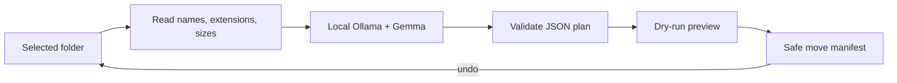

## What I built

SlothSort is a privacy-first Python CLI that organizes the immediate files in a messy folder. A Gemma model running locally through Ollama looks at filenames, extensions, and sizes, then proposes useful folders such as Finance, Photos, Notes, or Code.

The lazy payoff is simple: I review one dry-run instead of sorting every file myself.

Repository: https://github.com/ExPl0iT-29/slothsort

Demo: **TODO: add the final video or GIF URL before publishing.**

## Demo

The demo starts with an untidy sample folder, generates a local AI plan, applies it, and then restores everything with `--undo`.

```text
python slothsort.py demo-files
python slothsort.py demo-files --apply
python slothsort.py demo-files --undo
```

## How it works



The model never receives file contents. SlothSort validates every filename and category returned by the model, rejects traversal and duplicates, refuses overwrite collisions, and records an undo manifest before moving anything.

## Why open innovation matters

Folder names and filenames can expose personal information. Running an open-weight Gemma model locally means that metadata stays on my machine. Ollama also makes the runtime replaceable: users can inspect the integration, select a smaller or larger Gemma model, or point the same transparent interface at another local model.

A closed hosted model would make the CLI easier to deploy, but it would weaken the privacy story and add a recurring network and API dependency. Here, openness is not decoration—it is what makes the tool appropriate for personal files.

## Built with

- Python standard library
- Ollama
- Gemma 3

## What I learned

The interesting part was not moving files; Python already does that well. The real work was treating model output as untrusted input. A local model can still return malformed JSON, repeat a filename, invent a source, or suggest a dangerous path. The validation layer is what turns the model suggestion into a safe, reversible action.

## Prize categories

- Best Use of Gemma — Gemma performs the core semantic classification locally through Ollama.

## AI disclosure

OpenAI Codex assisted with implementation, tests, documentation, and this draft. I reviewed the code and will verify the final Gemma demo before submitting.
