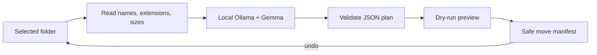

*This is a submission for the [Hacktoberfest Open-Source AI Challenge Week 3: Slow and Steady](https://dev.to/challenges/hacktoberfest-week3-2026-10-19)*

## What I Built

SlothSort is a privacy-first Python CLI that organizes the immediate files in a messy folder. A Gemma model running locally through Ollama looks at filenames, extensions, and sizes, then proposes useful folders such as Finance, Photos, Notes, or Code.

The lazy payoff is simple: I review one dry-run instead of sorting every file myself. Nothing moves until I explicitly add `--apply`, and the latest run can be reversed with `--undo`.

## Demo

**TODO: replace this line with the final video or GIF URL before publishing.**

The demo should show an untidy copy of the included sample folder, generate a local AI plan, apply it, and restore everything:

```text
Copy-Item sample demo-files -Recurse
python slothsort.py demo-files
python slothsort.py demo-files --apply
python slothsort.py demo-files --undo
```

## Code



The project is MIT licensed and uses only Python's standard library at the application layer.

## How I Built It

SlothSort scans only the immediate files in the selected folder and sends their names, extensions, and sizes to a local `gemma3:1b` model through Ollama's HTTP API. File contents never enter the prompt.



I treated model output as untrusted input. SlothSort rejects malformed JSON, invented or duplicated files, incomplete plans, path traversal, unsafe category names, and overwrite collisions. It writes an undo manifest before moving anything and rolls back completed moves if an operation fails.

Six standard-library tests cover validation, collision refusal, apply/undo, a tampered manifest, and the Ollama HTTP response contract.

## Why Does Open Innovation Matter?

Folder names and filenames can expose bills, clients, projects, and personal interests. Running an open-weight Gemma model locally means that metadata stays on my machine. Ollama also makes the runtime replaceable: users can inspect the integration, choose another Gemma size, or point the same transparent interface at another local model.

A closed hosted model would make the CLI easier to deploy, but it would weaken the privacy story and add a recurring network and API dependency. Here, openness is what makes the tool appropriate for personal files.

## The Lazy Payoff

One reviewed command can categorize every immediate file in a folder, while the dry-run and undo path keep the automation low-risk. The included sample makes the full plan/apply/restore loop reproducible without risking personal data.

## Prize Categories

- **Best Use of Gemma** — Gemma performs the core semantic classification locally through Ollama.

## AI Disclosure

OpenAI Codex assisted with implementation, tests, documentation, and this draft. I reviewed the code and will verify the final Gemma demo before submitting.
