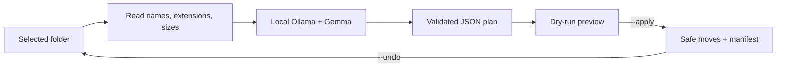

# SlothSort

SlothSort is a privacy-first CLI that lets a local Gemma model organize one messy folder for you. It shows a dry-run first, never overwrites files, and can undo the latest organization pass.

Built for the Hacktoberfest 2026 Week 3 **Slow and Steady** challenge: make something with open-source AI that rewards laziness.

## Why open AI

Filenames can reveal bills, clients, projects, and personal interests. SlothSort sends only filenames, extensions, and sizes to a Gemma model running locally through Ollama. Nothing needs to leave the machine, and the model can be inspected or replaced.

## How it works



SlothSort scans only the immediate files in the selected folder. It rejects malformed model output, path traversal, duplicate entries, unknown files, and destination collisions.

## Requirements

- Python 3.10+
- [Ollama](https://ollama.com/)
- A local Gemma model

```powershell
ollama pull gemma3:1b
```

## Try the included sample

Copy `sample` so the repository fixtures stay unchanged:

```powershell
Copy-Item sample demo-files -Recurse
python slothsort.py demo-files
```

Review the dry-run. To apply it:

```powershell
python slothsort.py demo-files --apply
```

To restore the files:

```powershell
python slothsort.py demo-files --undo
```

Use another installed model or Ollama endpoint when needed:

```powershell
python slothsort.py "$env:USERPROFILE\Downloads" --model gemma3:4b --ollama-url http://127.0.0.1:11434
```

## Safety choices

- Dry-run is the default.
- Only immediate files are scanned; directories and hidden files are ignored.
- Model categories cannot contain path separators or escape the chosen folder.
- Every source file must appear exactly once in the model plan.
- Existing destinations are never overwritten.
- `--apply` records `.slothsort-manifest.json`; `--undo` uses it to restore files.

Do not test file organizers on valuable data first. Use a copy or the included sample.

## Tests

```powershell
python -m unittest -v
```

The tests cover traversal rejection, incomplete plans, collision refusal, apply/undo, and the Ollama HTTP response contract.

## Limitations

- One folder level per run.
- Category quality depends on filenames and the selected model.
- Undo covers the latest successful SlothSort run only.
- Ollama and the selected Gemma model must already be running locally.

## AI disclosure

OpenAI Codex assisted with implementation, tests, documentation, and the submission draft. The project uses Gemma through Ollama at runtime.

## License

[MIT](LICENSE)
